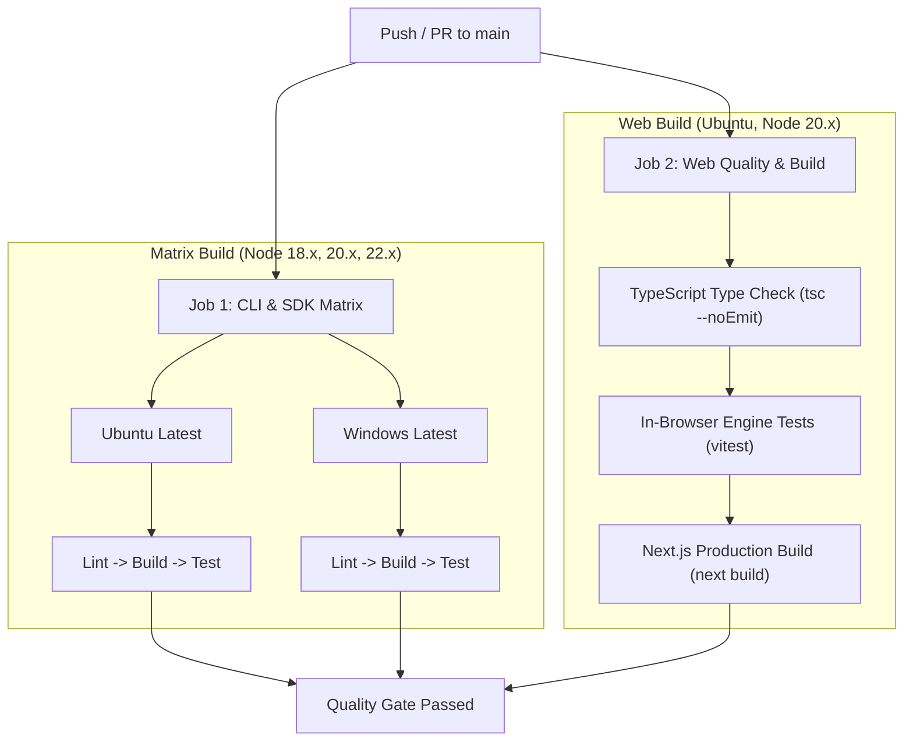

# Development Workflow

This document establishes the repository standards, commit guidelines, testing discipline, and continuous integration lifecycle for Context Pack contributors.

---

## 1. Branching Strategy

The repository follows a trunk-based development flow with feature branches:

```text
main (production stable release)
  ├── feat/task-aware-slicing
  ├── fix/cli-comma-separated-files
  └── docs/developer-handbook-refactor
```

- **`main`:** Production-ready branch. Every push triggers GitHub Actions CI. Direct force pushes are disabled.
- **Feature Branches:** Named using `feat/<feature-name>`, `fix/<bug-name>`, or `docs/<doc-name>`.

---

## 2. Commit Message Conventions

Commits must follow the [Conventional Commits](https://www.conventionalcommits.org/) specification:

```text
<type>(<optional scope>): <short description in present tense>
```

### Supported Types

| Type | Purpose | Example |
| :--- | :--- | :--- |
| `feat` | Adding new user-facing functionality | `feat(core): implement task-aware window slicing` |
| `fix` | Resolving bugs or incorrect behaviors | `fix(cli): parse comma-separated file arguments` |
| `docs` | Documentation and diagram changes | `docs(benchmark): update empirical report with VibeGraph results` |
| `test` | Adding or updating unit/integration tests | `test(slicer): add hotspot line alignment tests` |
| `refactor`| Code refactoring without behavior changes | `refactor(tokenizer): simplify encoder cache lookup` |
| `chore` | Build tasks, release version bumps | `chore: bump version to 0.1.2` |

---

## 3. Testing Approach & Discipline

Context Pack enforces a strict test-driven development (TDD) discipline:

1. **Deterministic Assertions:** All tests run locally without network mocking, external servers, or non-deterministic timers.
2. **Quality Gates:** 100% of test suites must pass before committing or cutting a release.
3. **Dual Suite Validation:**
   - **Root Engine Suite:** `npm test` runs 46 tests across 6 files in `test/` using Vitest.
   - **Web Engine Suite:** `cd web && npm test` runs 14 tests across in-browser modules in `web/src/lib/engine/`.

```bash
# Run root test suite
npm test

# Run tests in watch mode during development
npm run test:watch

# Run web client test suite
cd web && npm test
```

*(source: `package.json:30-32`, `web/package.json:10`)*

---

## 4. Continuous Integration Pipeline (GitHub Actions)

CI executes automatically on pushes and pull requests to `main` via `.github/workflows/ci.yml`:



*(source: `.github/workflows/ci.yml:1-72`)*

---

## 5. Pre-Release Verification Checklist

Before publishing a new version to npm:

1. [ ] **Type check root:** `npm run lint` passes with 0 TypeScript diagnostics.
2. [ ] **Compile root:** `npm run build` generates clean ESM artifacts in `dist/`.
3. [ ] **Root tests:** `npm test` passes 46/46 tests.
4. [ ] **Type check web:** `cd web && npx tsc --noEmit` succeeds.
5. [ ] **Web tests:** `cd web && npm test` passes 14/14 tests.
6. [ ] **Web production bundle:** `cd web && npm run build` compiles cleanly.
7. [ ] **Version bump:** Run `npm version patch` (or `minor`).
8. [ ] **Publish:** Run `npm publish`.
