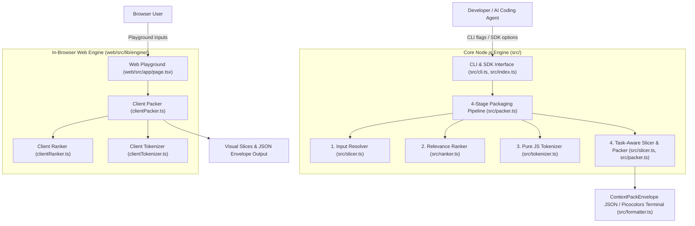

# System Architecture

Context Pack is a deterministic, token-budgeted context packaging engine designed for autonomous AI coding agents and CLI power users. It extracts and packs high-value source code slices under strict token budgets using local, in-memory heuristic ranking and token counting.

## 1. System Overview & Boundaries

Context Pack operates as a zero-network, zero-WASM standalone module available as both a Node.js CLI/SDK and an in-browser Web client engine.

*(source: `src/packer.ts`, `web/src/lib/engine/clientPacker.ts`)*

---

## 2. Four-Stage Core Ingestion Pipeline

The packaging pipeline executes deterministically in memory through four discrete processing stages:

### Stage 1: Input Resolver
- Resolves file globs and paths using `fast-glob` with cross-platform slash normalization.
- Rejects empty match sets with `NO_FILES_MATCHED` error.
- Reads file content asynchronously into UTF-8 strings.
- *(source: `src/slicer.ts:129-155`)*

### Stage 2: Relevance Ranker
- Strips accents and tokenizes task instructions into keyword sets.
- Expands English and Vietnamese synonyms via bidirectional dictionary `VI_EN_SYNONYMS`.
- Evaluates keyword coverage, occurrence frequency bonus, and filepath name bonus.
- Filters candidates below `minRelevance` threshold.
- *(source: `src/ranker.ts:24-102`, `src/dictionary.ts`)*

### Stage 3: Tokenizer
- Encodes strings into BPE tokens using `js-tiktoken` without native compilation or WASM.
- Supports `cl100k_base` (GPT-4/GPT-3.5), `o200k_base` (GPT-4o), `p50k_base`, and `r50k_base`.
- Caches encoder instances in a singleton map for performance.
- *(source: `src/tokenizer.ts:4-31`)*

### Stage 4: Task-Aware Window Slicing & Knapsack Packing
- Evaluates line-by-line keyword matches to locate the semantic center ("hotspot") of a target file.
- Allocates an asymmetric window (~35% lead context before hotspot, ~65% trailing implementation after) capped at `maxSliceLines` (default: 100 lines).
- Implements a greedy knapsack algorithm to pack highest-scoring slices within `budget_tokens` ceiling.
- Sets `truncated: true` if additional candidates exceed the remaining token budget.
- *(source: `src/slicer.ts:43-112`, `src/packer.ts:57-76`)*

---

## 3. Dual Execution Architecture

| Component | Node.js Core (`src/`) | Web Client (`web/src/`) |
| :--- | :--- | :--- |
| **Runtime** | Node.js ≥ 18 (ESM) | Modern Browser (React 19, Next.js 16 Turbopack) |
| **File Access** | `node:fs/promises`, `fast-glob` | In-memory `VirtualFile[]` store |
| **Tokenizer** | `js-tiktoken` (Node runtime) | `js-tiktoken` (Browser bundle) |
| **Output** | Picocolors terminal stdout or JSON file | Interactive visual DOM slices & raw JSON viewer |
| **Latency** | ~15–50ms on small repos, <1.5s on 1,000 files | ~5–20ms instant client-side execution |

*(source: `package.json`, `web/package.json`)*
