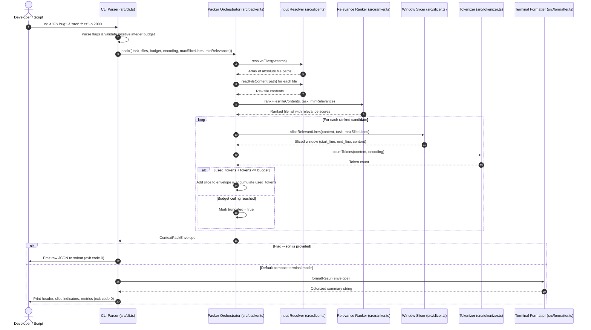
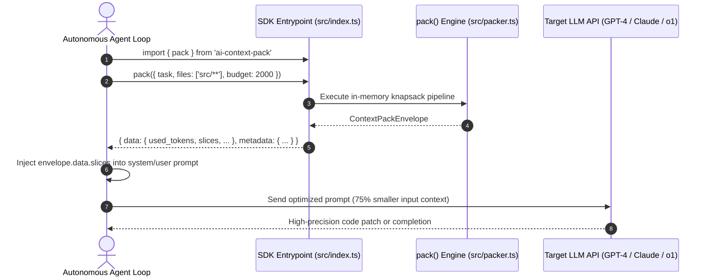
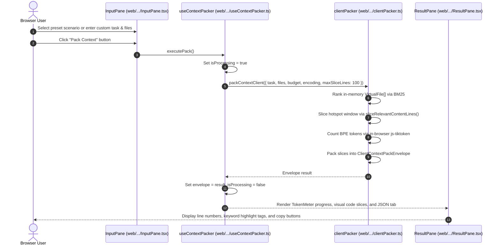
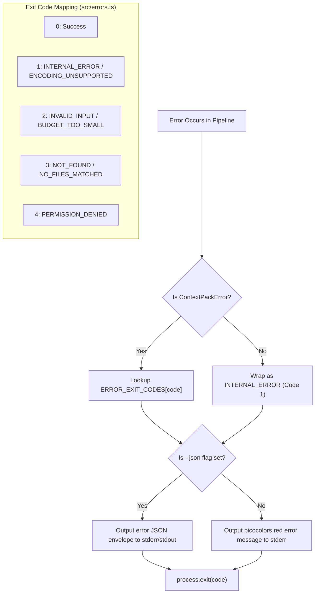

# Business Flow & Execution Sequences

This document outlines the step-by-step sequence diagrams and data interactions for the three primary usage flows of Context Pack: CLI invocation, TypeScript SDK integration, and the Web Playground.

---

## 1. Flow 1: Terminal CLI Execution

When a developer or CLI wrapper executes `cx -t "<task>" -f "<files>" -b <budget>`, the command-line entrypoint processes arguments, delegates to the packaging pipeline, and formats the output.

*(source: `src/cli.ts:10-72`, `src/packer.ts:13-96`, `src/formatter.ts:9-45`)*

---

## 2. Flow 2: Autonomous AI Agent / TypeScript SDK Integration

Autonomous coding agents (e.g. Claude Code, Cursor, custom agent loops) invoke Context Pack programmatically to retrieve bounded context before making LLM prompt calls.

*(source: `src/index.ts:1-7`, `src/types.ts:1-41`)*

---

## 3. Flow 3: Client-Side Interactive Web Playground

The Web Playground executes 100% inside the browser on the main thread with zero network calls, preventing proprietary code leaks.

*(source: `web/src/hooks/useContextPacker.ts:60-120`, `web/src/lib/engine/clientPacker.ts:75-180`, `web/src/components/playground/PlaygroundSection.tsx:30-80`)*

---

## 4. Error Handling and POSIX Exit Codes

When unexpected conditions occur, Context Pack handles errors through a typed `ContextPackError` hierarchy and maps errors to standardized POSIX exit codes:

*(source: `src/errors.ts:33-41`, `src/cli.ts:47-66`)*
