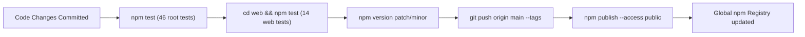

# Deployment & Release Operations

This document describes the automated CI/CD pipeline, npm package publishing procedures, and Vercel hosting setup for Context Pack.

---

## 1. Environments Overview

| Environment | Target Platform | URL / Distribution | Trigger |
| :--- | :--- | :--- | :--- |
| **npm Registry** | Global npm registry | `https://www.npmjs.com/package/ai-context-pack` | Tagged release commit via `npm publish` |
| **Web Production** | Vercel Edge Network | `https://context-pack-tool.vercel.app/` | Git push to `main` branch |
| **Continuous Integration**| GitHub Actions (Ubuntu/Win) | Repository Actions tab | Push or Pull Request to `main` |

---

## 2. npm Package Release Workflow

Releases are published directly from the `main` branch after passing all local and automated test suites.



### Step-by-Step Publishing Guide

1. **Verify working tree is clean:**
   ```bash
   git status
   ```

2. **Run full verification suite:**
   ```bash
   npm run lint
   npm run build
   npm test
   cd web && npm test && npm run build && cd ..
   ```

3. **Increment semantic version:**
   ```bash
   # For bug fixes and minor patch changes (e.g. 0.1.2 -> 0.1.3)
   npm version patch

   # For new features (e.g. 0.1.2 -> 0.2.0)
   npm version minor
   ```
   *This updates `package.json`, generates a git commit, and tags the commit (e.g. `v0.1.2`).*

4. **Push commits and tags to GitHub:**
   ```bash
   git push origin main --follow-tags
   ```

5. **Publish package to npm:**
   ```bash
   npm publish --access public
   ```

6. **Verify published release:**
   ```bash
   npm view ai-context-pack version
   ```

---

## 3. Web Playground Vercel Deployment

The interactive web client in `web/` is deployed automatically on Vercel.

### Vercel Project Configuration

- **Framework Preset:** Next.js
- **Root Directory:** `web`
- **Build Command:** `next build` (or `npm run build`)
- **Output Directory:** `.next`
- **Install Command:** `npm install --legacy-peer-deps`
- **Node.js Version:** `20.x`

### Preview & Production Deployments

- **Pull Requests:** Vercel automatically generates an isolated preview deployment with unique URL for UI verification.
- **Production Merge:** Merging into `main` automatically promotes the build to production at `https://context-pack-tool.vercel.app/`.

---

## 4. Continuous Integration (CI) Quality Gates

The GitHub Actions workflow (`.github/workflows/ci.yml`) enforces the following gates:

1. **Matrix Test Verification:**
   - Operating Systems: `ubuntu-latest`, `windows-latest`.
   - Node.js versions: `18.x`, `20.x`, `22.x`.
   - Execution: `npm ci` $\to$ `npm run lint` $\to$ `npm run build` $\to$ `npm test`.
2. **Web Quality Verification:**
   - Node.js 20.x on `ubuntu-latest`.
   - Execution: `npx tsc --noEmit` $\to$ `vitest run` $\to$ `next build`.

*(source: `.github/workflows/ci.yml:1-72`)*
