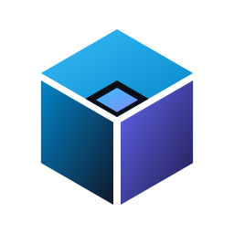
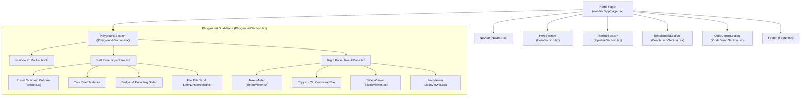

# UI Design & Web Playground Architecture

This document describes the design system tokens, component hierarchy, interaction patterns, and privacy architecture of the Context Pack Web Playground (`web/`).

---

## 1. Visual Theme & Design Principles

The Web Playground adheres to a strict developer-first aesthetic optimized for code legibility:

- **OLED Pure Dark Palette:** Deep background surfaces (`#090D16` canvas, `#0B0F19` card frames, `#1E293B` borders) prevent eye fatigue during prolonged coding sessions.
- **Accents:** Cyan (`#06B6D4` / `#22D3EE`) for active selections and primary buttons; Emerald (`#10B981`) for tokens saved and budget headroom; Indigo (`#6366F1`) for secondary controls.
- **Strict Zero-Emoji Rule:** All status states and actions use Lucide SVG iconography (`Sparkles`, `Cpu`, `ShieldCheck`, `Terminal`, `Check`, `Copy`) rather than unicode emojis, preserving professional IDE polish.
- **Typography:** JetBrains Mono / Fira Code / Consolas for code blocks, metrics, and line gutters; Inter / sans-serif for UI labels and navigational prose.

*Figure 1: Context Pack isometric vector brand mark with token crystal motif.*

*(source: `web/src/app/page.tsx:17`, `web/src/components/`)*

---

## 2. Component Hierarchy

*(source: `web/src/components/playground/PlaygroundSection.tsx:67-105`)*

---

## 3. Specialized Custom Components

### Twin-Scroll `LineNumberedEditor`
- **Problem:** External rich code editors (Monaco / CodeMirror) add 5MB+ to the initial bundle.
- **Solution:** Pure React twin-scroll editor (`InputPane.tsx:50-108`) with synchronized line-number gutter. When the textarea scrolls vertically, `onScroll` mirrors `scrollTop` to the read-only gutter element.
- **Auto-scroll Reset:** Switching between candidate file tabs automatically resets vertical scroll to line 1 (`scrollTop = 0`).

### `TokenMeter`
- Visualizes token consumption against the budget ceiling (`used_tokens / budget_tokens`).
- Color scales dynamically:
  - Emerald (`< 75%` capacity): Healthy headroom.
  - Cyan / Sky (`75% – 95%` capacity): Optimal saturation.
  - Amber / Red (`> 95%` or `truncated: true`): Budget ceiling warning indicator.

### `SlicesViewer`
- Renders extracted code blocks with accurate starting line numbers (`L{start_line}–{end_line}`).
- Lines matching task keywords are highlighted with `bg-cyan-950/25` and a left border `border-cyan-400`.
- Matched keyword tokens within the code lines are highlighted with `<mark>` pill chips.

---

## 4. Bilingual Client-Side i18n

Language switching (English $\leftrightarrow$ Vietnamese) executes entirely in client memory without page reloads:

- Dictionaries are declared as strongly typed const objects in `web/src/lib/i18n/dictionaries.ts`.
- `useLanguage` hook persists user preference in `localStorage`.
- Preset scenario titles, descriptions, and sample tasks adapt immediately when toggling languages while preserving custom user inputs.

---

## 5. Zero-Leak Privacy Guarantee

All packing operations within the Web Playground execute on the browser client's main thread via `web/src/lib/engine/clientPacker.ts`. No virtual file contents, task briefs, or generated tokens are sent over the network to any backend server.
